# ArchForge

**An architecture-to-code agent.** ArchForge reads an architecture document plus PlantUML views, finds the
defects in that specification, and then uses a team of sandboxed sub-agents built on a Claude-Code-style tool loop
to generate a **tested, traceable Windows desktop application**. It runs on DeepSeek `deepseek-v4-pro` and keeps
each run under **$1**.

> Evaluation task 1 for Prof. Peng Liang's group (Wuhan University) · Zain Ali, Nanjing Tech University

| | |
|---|---|
| **Input** | `Architecture_Documentation.md` + `Architecture_View.md` (13 PlantUML diagrams) |
| **Output** | Full Node.js 18 + Express project, wrapped as an **Electron desktop game** with a REST API, Jest tests, OpenAPI, SQL DDL, Dockerfile, README, traceability matrix and a log of every design decision |
| **Typical run** | ~15–18 min, **$0.30–0.40**, 85–92 % prompt-cache hit rate, 45–65 generated tests |
| **Deliverable** | `ArchForge.exe` (double-click). Python and Node.js are bundled, nothing to install |

---

## Quick start

**Windows, no installation:** download `ArchForge-win64.zip` from the [Releases](../../releases) page, unzip it,
and double-click `ArchForge.exe`. Then:

1. Paste your DeepSeek API key, or leave the field empty if `DEEPSEEK_API_KEY` is set. **Check key** is free.
2. The two input files are pre-filled. Choose an output folder.
3. Click **▶ Generate project** and watch the phases, cost meter and agent log live.
4. When it finishes, click **Build SpaceFractions .exe** and double-click the result to play.

`ArchForge.exe --smoke` runs an offline self-check (no key, no cost).

**From source:**
```bash
pip install -r requirements.txt
python -m archforge.gui                 # desktop GUI
python -m archforge --cn-mirror         # same pipeline from the command line
python -m archforge.spec                # spec analysis only (0 LLM calls)
python -m archforge.evaluate            # ablation study + independent acceptance probe
python -m pytest -q                     # 94 tests, no API cost
```

---

## How it works

```mermaid
flowchart LR
    A[Architecture docs<br/>+ PlantUML] --> B[Parse<br/>raw IR]
    B --> C[Spec Lint<br/>21 rules]
    C --> D[Resolved IR<br/>+ decision log]
    D --> E[Architect<br/>plan contract]
    E --> F[Scaffold<br/>pinned deps, OpenAPI, SQL]
    F --> G[Tester<br/>tests from spec, then LOCKED]
    G --> H[Coders x6<br/>scoped sub-agents]
    H --> I[Verify + Repair<br/>jest --json]
    I --> J[Reviewer<br/>read-only]
    J --> K[Traceability<br/>REQ - code - test - result]
```



**Principle:** code does everything that must be exact, the LLM does everything that needs judgment, and **code
checks every LLM output**.

| Phase | Who | What and why |
|---|---|---|
| **1. Parse** | code | A line-aware Markdown parser and a PlantUML parser for all 4+1 view types produce `ir.raw.json`. Every fact carries `file:line`, so it can be verified in seconds. |
| **2. Spec Lint** | code | **21 generic rules** find defects in the spec. Each finding has a severity, evidence and a resolution. The fixes are applied to a copy (`ir.resolved.json`), and every change is logged against its finding in `assumptions.md`. The raw IR is never modified. |
| **3. Plan** | Architect agent (thinking, JSON) | Produces a contract: files, exports, endpoint shapes and errors, and which requirement each piece serves. A validator rejects incomplete plans and retries once; a deterministic fallback fills any remaining gap. |
| **4. Scaffold** | code | `package.json` with **pinned, real dependencies** (prevents package hallucination). `openapi.yaml` is generated from the IR and SQL DDL from the IR tables. Then `npm install`. |
| **5. Tests** | Tester agent | Writes Jest + supertest tests **from the spec, before any code exists**. Test names start with requirement IDs. Then `tests/` is **locked with SHA-256**. |
| **6. Code** | 6 Coder agents | One per component (core, question, game, user, admin, UI). Each starts with a fresh context and a **write scope**, and can run the locked tests. |
| **7. Verify + repair** | code + Repair agent | `jest --json`. Only the relevant failures go to the Repair agent (thinking on), for up to 3 rounds; it stops after 2 rounds without progress. A Repair agent that believes a test is wrong must raise a **TEST DISPUTE** instead of working around it. |
| **8. Review** | Reviewer (read-only) | Returns JSON findings and judges any disputes. A test found wrong is fixed by the *Tester*, never by a Coder. |
| **9. Trace** | code | Scans `@req` tags and test names, combines them with the Jest results, and writes `TRACEABILITY.md`/`.csv`, a plan-conformance report and the README, all from real data. |

### The agent loop (the Claude-Code-style core)

The model never touches the machine. It requests one of **7 tools** (`read_file`, `write_file`, `edit_file`,
`list_dir`, `grep`, `run_command`, `todo_write`). ArchForge checks each request, runs it, and returns the result as
text, including errors, so the model can correct itself. The loop repeats until the model answers without a tool
call.

| Mechanism | Source idea |
|---|---|
| Tool registry (JSON schema + dispatch), runtime-assembled system prompt | how-claude-code-works ch. 13, *minimal components* |
| `edit_file` = exact string replace, **unique match required**, `replace_all` option, CRLF-safe, curly-quote tolerant | ch. 5 *code editing strategy* (FileEditTool) |
| **Read-before-edit enforced in code**, including "file changed on disk since you read it" | ch. 5 (`readFileState`) |
| Safe defaults: tools are write/unsafe unless declared `read_only`; read-only calls run in parallel, writes serially | ch. 4 (`isReadOnly`, `isConcurrencySafe`) |
| Tool output truncated to **head + tail** (errors live at the end) | ch. 13 (`truncateResult`) |
| **Microcompact**: old large tool results replaced by a stub, no API call | ch. 3 *context engineering* |
| Sub-agents with fresh context, restricted tool sets; read-only Reviewer | ch. 7 *multi-agent* (Explore/Plan agents) |
| Permission modes `read-only` / `workspace-write` | claw-code (`ReadOnly` / `WorkspaceWrite`) |
| `todo_write` visible plan | Claude Code `TodoWrite` |
| Stuck guard (same failing call 3×), wrap-up turn at the turn limit | ArchForge additions |

---

## Results

### 1. Spec defects found (input documents)

21 findings: **5 errors, 10 warnings, 6 info**. 19 of 21 rules fire; 2 pass, which shows the checks are real. For
example:

- Traceability points to `sql/question_ddl.sql`, but deliverables list `sql/game_ddl.sql`, and no `questions` table exists anywhere.
- ASR-2 (security) is used 6 times but missing from the traceability matrix. AdminComponent is in the diagrams, but not in the text.
- `Question` has no correct-answer field, yet the sequence diagram does "check answer".
- The SLO says 99.99 %, which implies a 0.01 % error budget, not the 1 % the document states (100× too loose).
- The OpenAPI defines **1 endpoint** while the diagrams need **10**; 3 use cases have no requirement; the state machine has no final state.
- ID types disagree (`string` in the class diagram vs `integer`/`int32`/`SERIAL` in the contracts); 5 of 12 stack justifications don't fit the requirement they cite.

Evaluation data: [docs/evaluation/](docs/evaluation/). Full lint report: generated projects contain `docs/spec/lint_report.md` and `docs/spec/assumptions.md`.

### 2. Independent acceptance probe

`archforge/evaluate/probe.py` starts the generated server as a real process and runs **13 black-box HTTP checks**:
spec contract, fresh-install playability, gameplay, pause/resume/quit, help, admin security, bank replacement,
**fair play**, **durability across restart** and error format. It never reads the generated tests, so weak tests
cannot fool it. The probe is tested too: a reference server scores 13/13, and the probe catches a planted
"no shuffle" defect.

**History of real runs. Every run passed 100 % of its own tests, and the probe still found real bugs:**

| Run | Own tests | Probe | Bugs the tests missed → fix added to ArchForge |
|---|---|---|---|
| 1 | 51/51 | **10/13** | empty question bank on first launch; correct answer always in position 0 → *seed-data convention + `launch.test.js`, fairness rule + `fairness.test.js`* |
| 2 | 63/63 | **11/13** | questions still served while the game is paused; no shuffle → *state rules for every endpoint* |
| 3 (GUI) | 65/65 | **13/13** | none |

### 3. Ablation study

Same inputs, model and sandbox, with a $0.50 cap per variant (`python -m archforge.evaluate`).

| Variant | Probe (of 13) | Own tests | Cost | Time |
|---|---|---|---|---|
| **full ArchForge** | **12** | 44/45 | $0.397 | 18.7 min |
| no Spec Lint (raw IR) | **2** | 52/52 | $0.294 | 12.2 min |
| no test-first, no repair | **12** | none | $0.283 | 11.9 min |
| single agent (same tools, no pipeline) | **1** | 28/28 | $0.073 | 4.0 min |

**What it shows**

- **Spec Lint is the largest single factor (12 → 2).** Without it, the agents followed the class diagram's
  `id: string` and returned UUID game IDs, breaking the specified `integer gameId` contract (rule SL-10 resolves
  exactly this). They also invented their own endpoint set because the spec defines only one. The project still
  passed **52/52 of its own tests**: *green tests, wrong system.*
- **A single agent with the same tools is not enough (1/13).** It declared success after 4 minutes with 28 passing
  tests of its own, but it had not even implemented the one endpoint the spec defines (`GET /play`).
- **Test-first: equal probe score in this sample (12 vs 12), different failures.** The full variant missed the
  paused-question rule; the no-tests variant missed fair play. Test-first produced measurable repair (24 → 44 of 45
  tests in round 1) and complete traceability. Without tests, 8 of 13 requirements stayed **UNTESTED**.
  The paused-question rule is now part of the conventions and the required tests.
- **Honest limit:** one run per variant. LLM output varies between runs, so the small differences (12 vs 12) are
  not statistically meaningful. The large ones (12 vs 2 vs 1) are.

### 4. Cost

- **Prompt caching keeps runs under $1.** All sub-agents share one byte-identical prefix (rules + IR digest + plan),
  and only the role text differs, at the end. In run 1, **1.2 M input tokens** were billed at the cache price:
  **¥0.36 instead of ¥10.94**. Without caching that run would have cost about **$1.86**.
- **Budget guard:** before every call, the worst-case cost (peak price) is estimated, and the call is **refused
  before DeepSeek is contacted** if it could cross the limit.
- DeepSeek's off-peak window (Beijing evening/night/weekend) halves the price; the cost meter accounts for it exactly.

---

## Security

| Risk | Protection |
|---|---|
| API key leakage | The key lives only in memory, the env var or Windows Credential Manager. It is never written to a file; it is registered with a redactor that masks it (exact match + `sk-…` patterns) in every log line, error and GUI message. `scripts/check_secrets.py` scans the repo before pushing. |
| Generated code reading the key | Child processes get an environment with every `KEY/TOKEN/SECRET/PASSWORD` variable removed. |
| Agent escaping the project | Path jail: every path is resolved (`..`, symlinks, drive letters) and must lie inside the workspace. |
| Dangerous commands | Allow-list (`node`, `npm` sub-commands, `npx` packages), no shell, metacharacters refused (`& \| ; > < $ % ^`, which also blocks Windows `.cmd` argument injection), inline code (`node -e`) refused, timeouts kill the whole process tree. |
| Test tampering | In a real run the Repair agent bypassed the file tools with `node -e`. So ArchForge does not rely on prevention alone: `tests/` is hashed (SHA-256) after the Tester runs and checked after every agent and before every test run; any change is **reverted** and reported. |
| Supply chain | `package.json` is written by code with pinned versions; agents cannot add dependencies. |

**Honest scope:** this is a *policy* sandbox, not OS isolation. `node` can run code the agent wrote, with the
user's permissions. The guarantees are: no secrets in the child environment, no writes through the tools outside
the workspace, no shell tricks, no runaway processes, and no undetected test changes.

---

## Repository layout

```
archforge/
  config.py redact.py pricing.py llm.py events.py   foundation: key handling, cost, budget guard, event log
  spec/          markdown + PlantUML parsers, IR builder, task constraints
  lint/          21 Spec Lint rules, resolver, reports
  agent/         sandbox, 7 tools, agent loop, system prompt
  orchestrator/  plan, scaffold, roles, verify, conformance, integrity lock, traceability, game .exe build
  evaluate/      acceptance probe + ablation runner
  gui/           PySide6 desktop GUI
inputs/          the two architecture documents
examples/        a complete generated project (Space Fractions)
tests/           94 tests (fake LLM, no API cost)
ArchForge.spec, build_exe.ps1, .github/workflows/build.yml    Windows .exe build (local + CI)
```

## Known limitations

- One generation run per ablation variant (cost-bounded); small score differences are within LLM variance.
- The sandbox is policy-based (see Security); Docker-based isolation is not available on the target Windows setup.
- The generated system is a **modular monolith**, not the microservices of the spec (decision recorded in Spec Lint
  finding SL-17: one module per component, one desktop process).
- The PlantUML parser covers the diagram types used here (use case, class, object, state, activity, sequence/collaboration, package, component, deployment, container), not the full PlantUML grammar.
